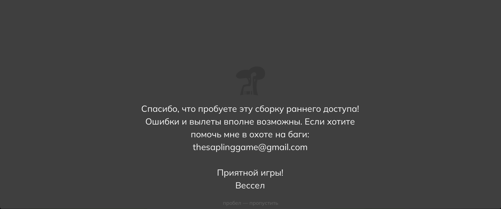
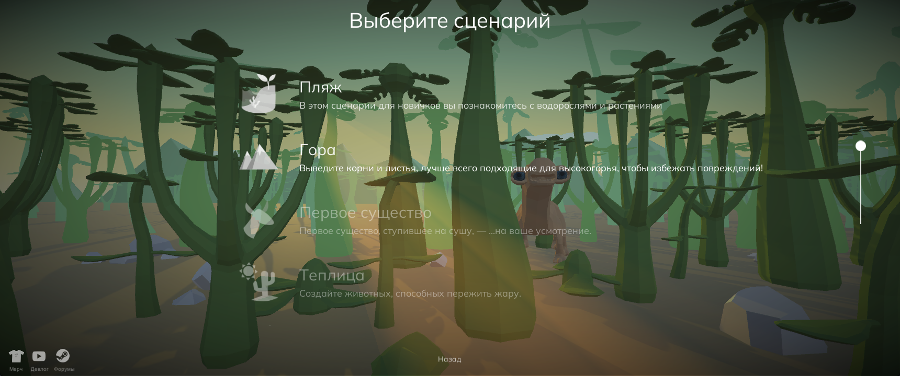
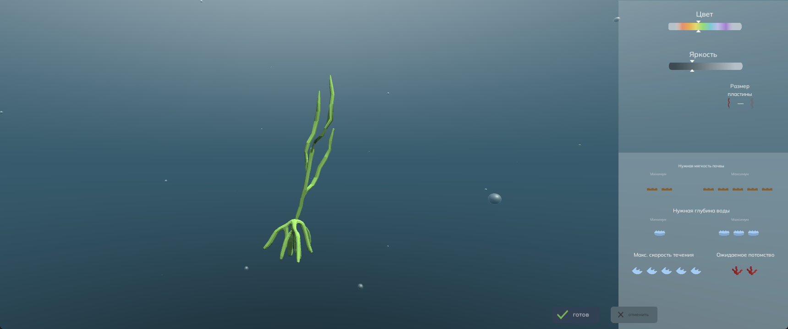

# The Sapling — русификатор + поддержка 21:9

Неофициальный русификатор игры [The Sapling](https://store.steampowered.com/app/997380/The_Sapling/) (версия **v13.57a**) и исправление интерфейса для широких мониторов (3440×1440 и другие 21:9).

## Что делает мод

**Перевод**
- ~1000 строк интерфейса, подсказок, причин смерти, этапов и целей сценариев, 240 описаний частей тела;
- шаблоны для фраз с числами и именами видов с правильными окончаниями («1 год», «3 года», «500 лет»);
- кириллица отображается родными шрифтами игры: встроенные Montserrat 6 и Muli заменены на Montserrat 7 и Mulish (те же шрифты, но с кириллицей);
- длинный русский текст в тесных рамках слегка ужимается, а не обрезается.

**Широкие мониторы**
- 3440×1440 и другие разрешения 21:9 появляются в окне запуска игры (там было разрешено только 16:9);
- интерфейс масштабируется так же, как на 16:9 той же высоты: ничего не уходит за верх и низ экрана, лишняя ширина остаётся по бокам;
- иконки-шкалы, 3D-превью и сетки, которые игра считает от ширины экрана, тоже подстроены.

## Установка

1. Скачайте архив `TheSapling-RU-*.zip` из раздела [Releases](../../releases).
2. Распакуйте его **в папку игры** (туда, где лежит `the_sapling.exe`), с заменой файлов.
3. Запустите `SaplingRU-Setup.exe` и выберите `1 — установить`.
   Установщик проверит, что файлы игры от версии v13.57a, сохранит оригиналы в `SaplingRU\backup` и наложит патчи на шрифты и настройки экрана.
4. Запустите игру и выберите нужное разрешение в окне запуска.

Если версия игры другая, установщик ничего не изменит. Перевод интерфейса при этом всё равно будет работать, но без кириллических шрифтов и без 21:9 в окне запуска.

## Настройки

- `BepInEx\config\ru.sapling.fixes.cfg` — исправление интерфейса для 21:9 (`[UI] Enabled`), ужатие текста, принудительное разрешение.
- `BepInEx\config\AutoTranslatorConfig.ini` — настройки XUnity.AutoTranslator.
  По умолчанию онлайн-переводчик выключен, и строки, которых нет в словаре, остаются на английском.
  Чтобы они переводились через Google, поставьте `Endpoint=GoogleTranslateCompat`.
- Словари лежат в `BepInEx\Translation\ru\Text\`, это обычные текстовые файлы `оригинал=перевод`. Правки подхватываются при следующем запуске.
- `ALT+T` в игре переключает между переводом и оригиналом.

## Удаление

Запустите `SaplingRU-Setup.exe` и выберите `2 — удалить`. Оригинальные файлы игры вернутся из бэкапа, файлы мода будут удалены.

## Состав репозитория

| Папка | Содержимое |
|---|---|
| `plugin/` | плагин BepInEx `SaplingFixes`: масштаб интерфейса на 21:9, ужатие длинного текста |
| `installer/` | установщик и бинарные патчи (`.srup`: bsdiff + gzip) для файлов игры v13.57a |
| `translation/` | словари перевода для XUnity.AutoTranslator |
| `config/` | конфиги XUnity и плагина |
| `fonts/` | шрифты с кириллицей, которые встраиваются в игру |
| `tools/` | скрипты на Python (UnityPy) для извлечения текстов и создания патчей |

Сборка плагина: `dotnet build plugin -c Release -p:GameDir="путь\к\игре"` (в игре должен стоять BepInEx 5).
Сборка установщика: `dotnet build installer -c Release`.

## Благодарности и лицензии

- [BepInEx](https://github.com/BepInEx/BepInEx) — MIT
- [XUnity.AutoTranslator](https://github.com/bbepis/XUnity.AutoTranslator) — MIT
- Шрифты [Montserrat](https://github.com/JulietaUla/Montserrat) и [Mulish](https://github.com/googlefonts/mulish) — SIL Open Font License 1.1
- Код и перевод этого проекта — MIT (см. `LICENSE`)

The Sapling — игра Wessel Stoop. Проект неофициальный и не связан с разработчиком. Файлы игры в репозитории не распространяются: патчи содержат только изменения.
